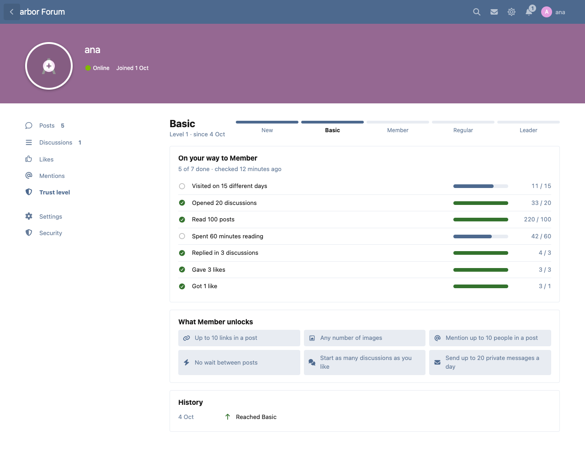
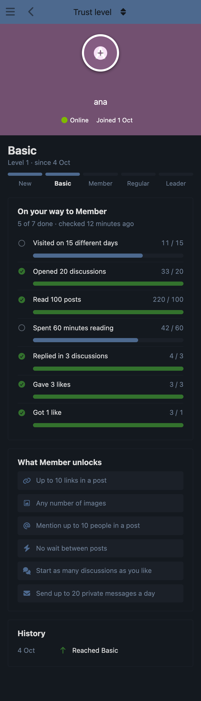
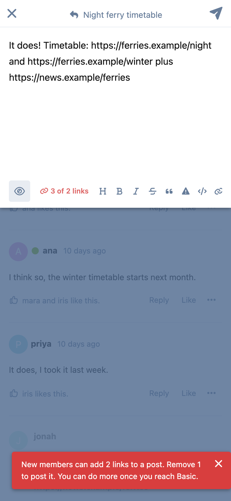
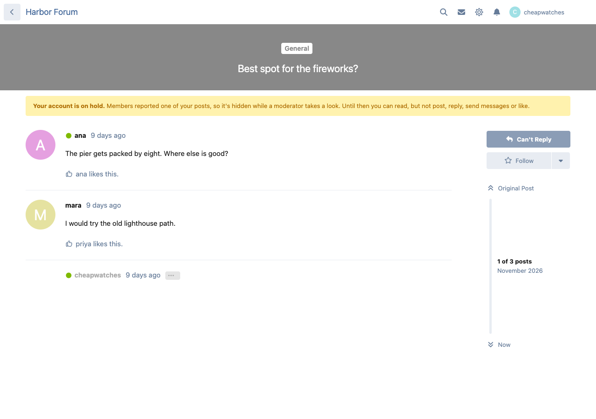
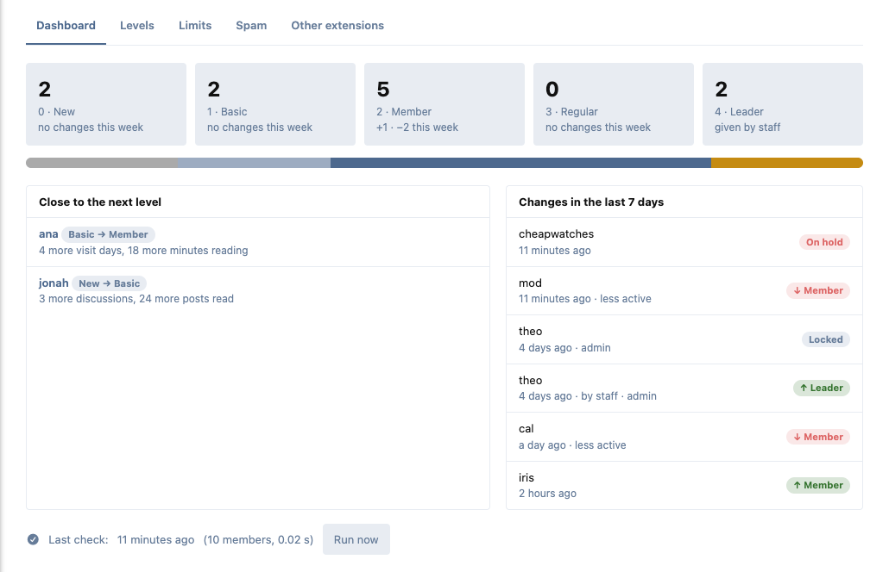
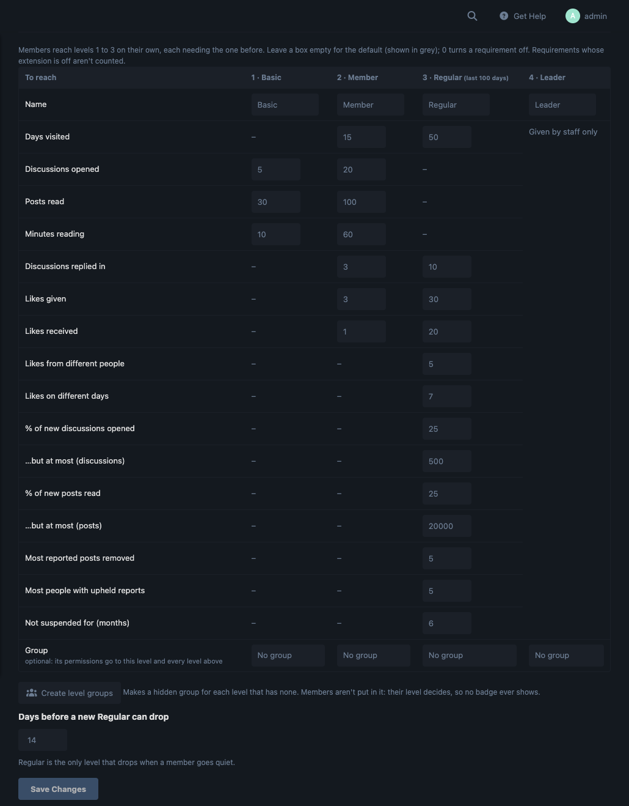

# Trust Levels

Members earn trust by taking part, the way [Discourse](https://blog.discourse.org/2018/06/understanding-discourse-trust-levels/) does it, for [Flarum 2](https://flarum.org).

New accounts start with limits that make spam useless. As members visit, read, reply and get liked, they move up on their own, and each level unlocks more. Posts the community reports are hidden at once.



## Levels

| Level | Reached by (defaults, all editable) |
|---|---|
| 0 · New | Signing up |
| 1 · Basic | Opening 5 discussions, reading 30 posts, 10 minutes reading |
| 2 · Member | Visiting on 15 days, opening 20 discussions, reading 100 posts, 60 minutes reading, replying in 3 discussions, giving 3 likes, getting 1 |
| 3 · Regular | Over the last 100 days: 50 visit days, replies in 10 discussions, a quarter of new discussions and posts read, 20 likes from 5 people on 7 days, 30 likes given, few reported posts, no suspension in 6 months |
| 4 · Leader | Given by staff |

- **Regular is the only level that drops** when a member goes quiet (10% leeway, two weeks' grace after reaching it).
- **Any level drops one step** when moderators uphold enough reports against a member in 6 months.
- **Staff can set and lock** a member's level, with a note (user controls → Trust level…).
- **Members who were here before you installed it** are placed from their history, never below Basic. New sign-ups start at New.
- Likes, reports and suspensions only count where Likes, Flags and Suspend are enabled.

Only the member and staff see a member's level. Each member gets a **Trust level** tab on their profile: where they are, what the next level needs, what it unlocks and their history. They get an alert when they move up (and an email if they turn it on).



## What each level unlocks

Limits are per level, and only ever take something away. Admins, moderators (the bypass permission) and any groups you pick are never limited.

- Links, images and people mentioned per post
- Seconds between posts, new discussions a day, private messages a day (Messages)
- Attaching files (FoF Upload) from a level you choose
- A New member's first posts wait for approval (Approval)

Members are told exactly why, and which level lifts it, and see a live count as they type.



Each level can also give the permissions of a hidden group, and they add up: give "Trust 2" a permission once, and Members, Regulars and Leaders all have it. Nobody is put in those groups, so no badge ever shows. **Create level groups** makes them for you.

## Spam defense

- When enough different members (Basic or above) report the same post, it's hidden at once.
- Its author, if New or Basic, is **put on hold**: they can read, but can't post, reply, edit, rename, message, like, react or vote until a moderator lifts it or confirms it's spam (hides their posts and suspends them).
- With **Docket** installed, its crowd moderation does the hiding, and each reporter counts by their level (New 0.5 up to Leader 1.5).
- With **Gatehouse** installed, someone put on hold in their first week goes back to its approval queue.
- With **Sleuth** installed, a member it links to a banned account stays New until staff review the match.



## For admins

Admin → Trust Levels: a dashboard (members per level, who's closest to their next level, this week's changes), the requirement grid, the limits grid, spam settings and other extensions.





## Other extensions

- **Ladder** keeps the ranks members see; Trust Levels decides what they may do and stays out of sight. A level can't use one of Ladder's rank groups.
- **Onramp**: a step "reach trust level N".
- **Buzz**: "Ana is now a Regular" in the live feed, off until you turn it on.
- **GDPR** (flarum/gdpr): a member's counts and history are in their data export and erased with them.

## Light on your forum

- No extra queries on any page: a member's level is a column on their account.
- Reading is counted from the request Flarum already sends as you scroll (one small write), and time spent reading from the gaps between those requests. No timers, no extra requests.
- Levels are checked by Flarum's scheduler every hour, only for members seen since the last check, a few queries per 200 members. New and Basic members are also checked as they read and post (at most every 10 minutes), so the first promotions work even without cron.
- Daily rows older than 100 days are folded into totals each night.

Make sure [Flarum's scheduler](https://docs.flarum.org/2.x/console#schedulerun) runs every minute. The dashboard warns you when it hasn't.

## Install

```sh
composer require ernestdefoe/trust-levels
php flarum migrate
php flarum cache:clear
```

Then enable it in the admin and press **Run now** on its dashboard to place your existing members.

## Update

```sh
composer update ernestdefoe/trust-levels
php flarum migrate
php flarum cache:clear
```

## Links

- [Source](https://github.com/ernestdefoe/trust-levels) · [Issues](https://github.com/ernestdefoe/trust-levels/issues)
- ☕ If you like the things I have built, consider [buying me a coffee](https://buymeacoffee.com/ernestdefoe).
